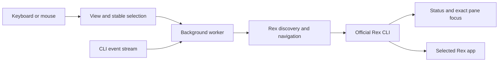

# brachio

A standalone TUI for coding agent status in Rex. Select an agent with the keyboard or mouse to ask one Rex app to show its session, tab, and pane.

Brachio does not send prompts, keys, or commands to agents. It is not a native sidebar and does not stay visible across tabs.


## Requirements and installation

- macOS or Linux with an interactive terminal and mouse reporting.
- For installation, use Cargo or [uv](https://docs.astral.sh/uv/). A PyPI wheel does not require Rust. Source builds require Rust stable and Cargo.
- The official Rex CLI, connected to the intended server. Brachio checks `PATH` first. On macOS, it also checks the app-managed installation described below.
- An open Rex app. Brachio uses the `session.select` app action to show a session or tab. This action requires **Remote Control**.
  - In Rex, open **Settings → Rex Server** and enable **Remote Control**. It is off by default.
  - Enable this only if you accept remote app control. Brachio does not change it.
  - If disabled, Rex rejects app selection with `Rex.app is not accepting actions`. Brachio shows the error in its status line until your next action; press `w` to read the full text. After enabling the permission, press Enter on the target agent to retry.

After publication, install from either registry:

```sh
cargo install brachio --locked
# Or install the native CLI from PyPI:
uv tool install brachio
# Run without a persistent installation:
uvx brachio --help
```

PyPI wheels target Linux (glibc 2.28 or newer) and macOS, on x86_64 and aarch64. Windows and musl wheels are not provided. Both distributions contain the same Rust CLI and use the version in `Cargo.toml`.

Build from source:

```sh
cargo build --release --locked
./target/release/brachio
# Optional local installation:
cargo install --path . --locked
```

## Start and operate

You can start Brachio from Ghostty or another terminal; it does not need to run inside Rex. Keep the Rex app open.

Brachio uses the first executable `rex` on `PATH`. If none is found on macOS, it checks:

```text
~/Library/Application Support/com.superlogical.rex/RexServer/Versions/Current/Rex Server.app/Contents/MacOS/rex
```

This uses Rex's current CLI without a fixed version number or changes to your shell or terminal configuration. If neither location has an executable CLI, Brachio reports an error before it changes terminal modes. On Linux, `rex` must be on `PATH`.

```sh
brachio
brachio --help
rex --autostart=false client ls --json
brachio --client 'client:<full-uuid-from-the-list>'
```

If `rex` is not on `PATH`, use the full CLI path above for the client-list command.

With one connected app, Brachio selects and retains its full client ID. Connection failures and an absent app are retried until the first pin. With multiple apps, use `--client` with a full ID; ambiguity remains refused until restart, even if an app later disconnects. Labels and suffixes are not accepted. Once pinned, a disconnected selected app prevents navigation without substitution. Restart to select a different client.

Brachio uses the CLI's normal server connection. Check `rex whoami --json` before starting if the server is uncertain. It does not aggregate hosts or start a missing server. Inherited `REX_CLIENT` does not override the selected app.

| Input | Operation |
| --- | --- |
| Up / Down or k / j | Select the previous / next visible agent; collapsed headers are selectable |
| PageUp / PageDown | Move the selection by one page of rows |
| Home / End | Select the first / last row |
| g / G | Cycle grouping forward / backward: None → Agent → Status → CWD → Session |
| s | Cycle row sorting: None → Status → Agent → CWD → Session; sort within each group when grouped |
| S (Shift+s) | Toggle group order: Default / Reverse; no effect without grouping |
| Tab / Shift+Tab | Select the first matching agent in the next / previous group; wrap at either end |
| Left / Right | Collapse / expand the selected group |
| Enter | Jump to the selected visible agent in Rex; on a collapsed group, expand only |
| Left click | Select and jump to an agent row; a group-header click only toggles its fold |
| Mouse wheel | Scroll without changing the selected agent |
| / | Edit the filter incrementally; a hidden selection moves to the first match |
| a / A | Select the next / previous matching Blocked or Error agent; wrap and expand its group |
| w | Open Details: full selected-agent values and IDs, status source, latest messages, client, view, and warnings |
| ? | Open keyboard help, grouped by task |
| Up / Down, PageUp / PageDown, Home / End, or wheel in overlays | Scroll Details or Help |
| q / Escape in overlays | Close Details or Help; w also closes Details and ? closes Help |
| q / Escape on the list | q exits; Escape clears an active filter and never exits |
| Ctrl-C | Quit from any view, including filter editing |
| Terminal resize | Recalculate the layout and visible rows |

The list has six independent columns: **Status**, **Agent**, **Working directory** (CWD), **Session**, **Tab**, and **Pane**. Session, Tab, and Pane use readable names, never a combined Location field or ID suffixes. Unnamed locations use display positions; generated tab names become `Tab N`.

Column widths use the terminal-cell width of matching agent values and headings, including agents in collapsed groups. Two spaces separate visible columns. Extra terminal width stays on the right rather than spreading columns apart. Natural widths are capped at 9, 20, 48, 24, 20, and 24 cells respectively. The rightmost cell is reserved for a scrollbar that appears when rows overflow the view. Columns never use that cell, so folding, filtering, and scrolling do not shift them. The selected-row highlight still spans the whole terminal width, and status labels on that row turn white for contrast; the status symbol still identifies the state.

When space is limited, values shorten before lower-priority columns disappear. Pane, Tab, and Session are hidden in that order when their minimum widths no longer fit. Very small views use status symbols and shorter Agent/CWD values before hiding essential fields. A **Working directory** heading that no longer fits becomes **CWD**. Visibility follows measured content, not fixed terminal-width breakpoints. Hidden values remain available in Details.

Long names end with `…`; long directories keep the path end visible. An absolute path under `HOME` is displayed with `~` at a path-component boundary. Abbreviation and clipping change display only: Details retains the original full path and exact navigation IDs.

Grouping and row sorting both default to **None**. The ungrouped list keeps snapshot discovery order rather than status priority. Discovery follows Rex's session order, then the returned block order, then canonical agent names within a pane. It is not the visual pane order. The default view has no grouping title or group headers. Keyboard hints appear only below the list. When space permits, a solid line appears below the column headings.

Press `s` to cycle row sorting: **None → Status → Agent → CWD → Session → None**. Without grouping, this sorts the whole list. With grouping, it sorts only members within each group and does not change group order.

- **None** restores the latest snapshot's discovery order, within each group when grouped.
- **Status** uses Blocked, Error, Done, Working, Idle, then Session/Tab/Pane names and exact identity. This restores the previous default ordering.
- **Agent** uses canonical agent names, not display labels.
- **CWD** uses full paths, with missing directories last.
- **Session** uses Session, Tab, and Pane names, then exact identity.
- Equal Agent or CWD sort values keep discovery order. Text comparisons are case-sensitive.

Press `S` (Shift+s) to toggle **Default / Reverse** group order. This reverses groups only; member order does not change. In CWD grouping, the missing-directory group moves from last to first in Reverse. In Status grouping, Reverse starts with Idle and ends with Blocked. `S` does nothing without grouping. Sorting and group direction remain active when grouping changes or data refreshes. They retain the selected agent's exact ID, filter, and fold state, and do not navigate Rex. They are not saved after exit.

Grouped views show the mode in the title. Foldable headers with matching-agent counts appear only when at least two nonempty groups remain after filtering. Headers start one column left of agent rows. Except in Status grouping, a header also summarizes its members' statuses, such as `!1 ●2`, when the group is collapsed or mixes statuses, so a collapsed group still shows Blocked or Error members. The summary drops out before the label and count when space is short. A selected collapsed header uses the full-row highlight. With zero or one group, there are no group headers or folds. Under actual multiple headers, Status, Agent, CWD, or Session grouping hides its matching data column without leaving an empty gap. With one group, that column returns. Tab and Pane remain independent in every mode. Equal group values appear together:

- **Agent** uses canonical agent names.
- **Status** uses this priority: **Blocked, Error, Done, Working, Idle**.
- **CWD** uses full reported paths, not clipped labels or repository roots.
  - Missing directories form one **Unknown** group, last in Default order and first in Reverse.
- **Session** uses session names, with exact IDs to keep same-name sessions separate.

Agent names, paths, and session names use case-sensitive text order. Group direction is independent of row sorting. Within each group, rows use the selected sort mode; None keeps discovery order.

Press `g` or `G` to change the grouping mode without changing the selected agent. `Tab` and `Shift+Tab` keep their group-jump operation: they skip the current group and select the first matching agent in the next or previous nonempty group, not the next or previous agent. With no visible selection, they select the first or last group; with one group, they select its first agent. They do not navigate Rex, expand folds, or act in None, Details, Help, or filter editing. Grouping, folds, and filters are not saved after exit.

Left / Right folds the selected group only when multiple group headers exist. A header click toggles that group without changing the selected agent or navigating. Collapsing the selected agent's group retains its exact ID; Enter expands the group without navigation. Press Enter again to navigate to that agent.

Press `/` to edit a case-insensitive substring filter. Every whitespace-separated term must match (AND). Use `agent:`, `cwd:`, `session:`, or `status:` to restrict a term to that field. Unqualified terms also search tab and pane names; unknown prefixes are literal text. For example, `agent:pi cwd:project status:blocked` requires all three matches. Filtering updates while you type or paste. A filter edit keeps the selected ID while it still matches; otherwise it selects the first match, so Enter after filtering jumps to a visible agent. Enter applies the query without navigation; Escape cancels editing and restores the previous query and, if that agent still exists, the previous selection. Outside editing, Escape clears the query. The title shows the active filter.

A refresh that hides the selected agent, for example after a status change, does not select another agent. A hidden selection cannot navigate. Use arrows, a group jump, an attention jump, or a click to select a matching target.

The title shows the agent count followed by colored nonzero status counts, such as `!2 ×1 ●3`, then the grouping mode, `Sort: None` or the selected row sort, `Group order: Default/Reverse` when grouped, and the active filter. When space is short, status counts drop first, then group direction, row sorting, and grouping; the filter is clipped last. Details always includes the complete view settings. Keyboard hints below the list include `s Sort`, `S Group order` when multiple group headers exist, and `a Attention (N)` when matching agents are Blocked or Error, when space permits.

The status line shows the connection state (**Connecting** before the first snapshot, then **Connected**, **Navigating**, or **Disconnected**), a nonzero warning count, and the latest notice. A notice is either feedback for your last action, such as a navigation error, or a persistent connection or client problem. Feedback lasts until your next list input; refreshes and opening Details or Help do not clear it. A notice that does not fit ends with `… (w)`, and Details shows the full text. `?` shows all controls even when footer hints do not fit.

Selection uses the session ID, block ID, and canonical agent name, not a row number. If the selected entry disappears, navigation stops until you deliberately select another row with arrows, a group jump, a filter edit, or a click. Snapshot changes invalidate old mouse hit regions. Queued input is read before list redraws; mouse-down events that arrive during a redraw are discarded with a retry message rather than mapped to a replacement row. Terminal events do not carry a display-generation token, so this is not a guarantee about delayed physical input.

**Working directory** means the current directory (CWD) reported by Rex for the recognized foreground agent. It is not an inferred workspace or repository root. Missing directories, exited agents, and unrelated foreground processes show `Unknown`. Brachio uses the existing process query; it does not send commands to the agent or inspect local project files.

## Agent and record rules

Recognized status `app` / `effective_app` values are `pi`, `claude-code` (alias `claude`), and `codex`.

- Pi status and foreground identity were observed on the local Rex installation.
- Claude Code and Codex mappings have fixture coverage only. Their actual status reporting depends on the agent and Rex integration; it is not native end-to-end support evidence.
- An exact recognized foreground script basename, `argv0`, or executable name can identify an agent without a status report. Brachio displays an **Idle** fallback, with zero records and an explicit no-report source in Details. An interpreter such as `node` or `python` alone cannot.
- Other applications and agents without an explicit recognized identity are omitted. An empty list is not proof that no agents are running.
- Status follows the Rex schema: **Blocked, Error, Done, Working, Idle**. Missing or unrecognized `state` values use **Idle**; there is no **Unknown** status. An empty `records` array means no status report, not a reported Idle state. No **Waiting** state or need for input is inferred from Blocked. A failed status query is shown as a warning.
- **Done** is a reported state, not proof of whole-session completion. Status timestamps do not establish elapsed task time.
- Records inherit `app` from their nearest reported ancestor if Rex does not supply `effective_app`. Duplicate parent IDs are ambiguous and do not establish inheritance. Replies over the protocol limit of 256 records are rejected.
- All records for the same recognized app in one pane become one row. The most urgent reported status wins; record order does not change the result.
  - Separate instances of the same app in one pane are intentionally not distinguished.
  - Different recognized apps in the same pane can have separate rows. Both navigate to that pane.
  - Subtasks without their own pane do not get a fictitious navigation target.
- `clear` records are omitted. Retained Done/Error reports remain visible after process exit. They do not establish that a process is still running.
- Only terminal blocks with matching, unambiguous session-view and block-list locations are navigable. Detached blocks, unknown placements, nonterminal blocks, and incomplete IDs are ignored with warnings where applicable.

## Updates, navigation, and safety

A background worker obtains the initial snapshot. The CLI event stream invalidates snapshots; event bursts are coalesced. Full reconciliation also runs two seconds after each completed refresh, so missed or unknown events cannot permanently leave old state. Commands run outside the input/render loop. One dedicated navigation thread performs focus and app selection; read-only snapshot and event workers cannot change focus. A slow full-session scan does not delay navigation to a healthy target pane.

Until the first snapshot arrives, the list shows `Connecting to Rex…` and failed attempts are retried. A later failed server snapshot retains the old list, dimmed as stale, shows a disconnected status, and disables navigation. Per-session or per-pane failures produce a partial list and warnings. Event-stream loss is shown as a warning while periodic snapshots continue; the listener reconnects. A silent recovered listener remains marked uncertain until it delivers an event.

Navigation rechecks the pinned client, action schema, pane location, and agent identity. It then issues exact-ID `focus`, verifies the resulting server focus, and sends `session.select` with both session and window IDs to that client. It does not retry a failed mutation or select a nearby pane.

`rex focus` and `rex window focus` change server state without Remote Control. Their success does not confirm that the app shows the target tab.

**Session focus is shared server state.** Other apps attached to that session can observe a focus change even though app selection targets only one client. If app selection is refused, server focus may already have changed; the error states this. A timed-out focus or app-selection request can still complete later. The separate Rex operations are not a transaction: concurrent layout or focus changes by another client remain a race. Brachio checks between operations but cannot lock the native app.

External commands use separate arguments, null stdin, bounded output, and deadlines (three-second Rex requests, four-second local command wall time). The event stream has no lifetime deadline. Shutdown cancels and reaps only Brachio-owned CLI process groups; it does not close Rex sessions, agent processes, or user terminals. Normal exit, handled signals, errors, and panic unwinding restore terminal modes. SIGKILL, process abort, or terminal failure cannot guarantee cleanup.

Rex labels and reports are untrusted display text. Control characters and direction overrides are removed. No terminal-screen scraping, database, plugin system, or multi-terminal backend is used.

## Verification

```sh
cargo fmt --all -- --check
cargo clippy --all-targets -- -D warnings
cargo test --all-targets
cargo build --release
uv lock --check
uv build
uvx --isolated --no-index --find-links dist brachio --version
uvx --isolated --no-index --find-links dist brachio --help
```

`uv build` builds a source distribution, then builds the local platform wheel from it. The CLI smoke tests do not start the TUI or contact Rex.

Tests use synthetic JSON, a local mock CLI, Ratatui's test backend, and owned PTYs. They do not control the real Rex app. See [Rex compatibility and handoff](docs/rex-compatibility.md) for the measured environment, repeatable read-only queries, test evidence, native UI checks, and release restrictions.

## Structure



- `src/model.rs`: identities, status ordering, report grouping, display filtering.
- `src/rex.rs`: verified CLI schemas, snapshots, and navigation.
- `src/process.rs`: bounded subprocess I/O and owned-process cleanup.
- `src/worker.rs`: reconciliation, event reconnect, and navigation scheduling.
- `src/tui.rs`: view state, rendering, selection, scrolling, and input.
- `src/tui/list.rs`: sorting, grouping, and filtering.
- `src/tui/presentation.rs`: responsive columns, status display, clipping, and footer text.
- `src/main.rs`: CLI, terminal guard, signal handling, and application loop.

## Recovery and release limits

Brachio retries transient connection and initial app-discovery failures. Exit and restart to choose another client or resolve ambiguous selection. It has no persistent state or migrations. Remove the local binary to uninstall. If an uncatchable termination leaves a damaged terminal, use that terminal's reset operation.

Native app switching and physical mouse delivery require the manual checks in the handoff document before claiming end-to-end platform support. Windows is not supported. The CI workflow checks Linux and macOS PTY/process behavior; native Rex UI behavior is not established by those tests.

The [publishing guide](docs/publishing.md) describes the single Release workflow for PR note checks, PAT-authenticated Release PRs, and publication to crates.io and PyPI, plus registry setup, verification, and recovery. Add or update a `.changenote/` note for changes that need a release, then run `changenote status`. A maintainer must configure `PAT_TOKEN` and both registries before merging a Release PR to publish. Separate manual release actions need explicit authorization. Publication is not a transaction across the two registries.
