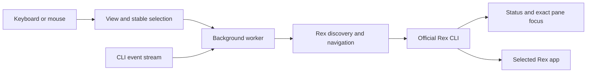

# brachio

A standalone TUI for coding agent status in Rex. Select an agent with the keyboard or mouse to ask one Rex app to show its session, tab, and pane.

Brachio does not send prompts, keys, or commands to agents. It is not a native sidebar and does not stay visible across tabs.

## Requirements and installation

- macOS or Linux with an interactive terminal and mouse reporting.
- Rust stable and Cargo. The development checks used Rust/Cargo 1.99.1.
- The official Rex CLI on `PATH`, connected to the intended server.
- An open Rex app. Navigation needs its **Remote Control** permission.
  - Enable this only if you accept remote app control. Brachio does not change it.

Build from source:

```sh
cargo build --release --locked
./target/release/brachio
# Optional local installation:
cargo install --path . --locked
```

The package is not published. The manifest disables registry publication.

## Start and operate

```sh
brachio
brachio --help
rex --autostart=false client ls --json
brachio --client 'client:<full-uuid-from-the-list>'
```

With one connected app, Brachio selects and retains its full client ID. Connection failures and an absent app are retried until the first pin. With multiple apps, use `--client` with a full ID; ambiguity remains refused until restart, even if an app later disconnects. Labels and suffixes are not accepted. Once pinned, a disconnected selected app prevents navigation without substitution. Restart to select a different client.

Brachio uses the CLI's normal server connection. Check `rex whoami --json` before starting if the server is uncertain. It does not aggregate hosts or start a missing server. Inherited `REX_CLIENT` does not override the selected app.

| Input | Operation |
| --- | --- |
| Up / Down | Select an agent |
| Enter | Navigate to the selected agent |
| Left click | Select and navigate to that row |
| Mouse wheel | Scroll without changing the selected agent |
| w | Open details with messages, warnings, and full values for the selected agent |
| Up / Down or wheel in details | Scroll details; w / Escape returns to agents |
| q / Escape / Ctrl-C | Exit |
| Terminal resize | Recalculate the visible rows |

Each row has separate **Working directory**, **Session**, **Tab**, and **Pane** columns. Locations use readable names, not ID suffixes. Unnamed sessions/tabs/panes use their display positions; generated tab names become `Tab N`. Long names end with `…`; long directories keep the path end visible. Press `w` and scroll to see complete column values and exact navigation IDs. Groups use this fixed priority: **Blocked, Error, Done, Unknown, Working, Idle**. No elapsed task time is inferred from status timestamps.

Selection uses the session ID, block ID, and canonical agent name, not a row number. If the selected entry disappears, navigation stops until you deliberately select another row. Snapshot changes invalidate old mouse hit regions. Queued input is read before list redraws; mouse-down events that arrive during a redraw are discarded with a retry message rather than mapped to a replacement row. Terminal events do not carry a display-generation token, so this is not a guarantee about delayed physical input.

**Working directory** means the current directory (CWD) reported by Rex for the recognized foreground agent. It is not an inferred workspace or repository root. Missing directories, exited agents, and unrelated foreground processes show `Unknown`. Brachio uses the existing process query; it does not send commands to the agent or inspect local project files.

## Agent and record rules

Recognized status `app` / `effective_app` values are `pi`, `claude-code` (alias `claude`), and `codex`.

- Pi status and foreground identity were observed on the local Rex installation.
- Claude Code and Codex mappings have fixture coverage only. Their actual status reporting depends on the agent and Rex integration; it is not native end-to-end support evidence.
- An exact recognized foreground script basename, `argv0`, or executable name can identify an agent with **Unknown** status. An interpreter such as `node` or `python` alone cannot.
- Other applications and agents without an explicit recognized identity are omitted. An empty list is not proof that no agents are running.
- Missing or future states are **Unknown**, never assumed Working or Idle. A failed status query is shown as a warning.
- Records inherit `app` from their nearest reported ancestor if Rex does not supply `effective_app`. Duplicate parent IDs are ambiguous and do not establish inheritance. Replies over the protocol limit of 256 records are rejected.
- All records for the same recognized app in one pane become one row. The most urgent reported status wins; record order does not change the result.
  - Separate instances of the same app in one pane are intentionally not distinguished.
  - Different recognized apps in the same pane can have separate rows. Both navigate to that pane.
  - Subtasks without their own pane do not get a fictitious navigation target.
- `clear` records are omitted. Retained Done/Error reports remain visible after process exit. They do not establish that a process is still running.
- Only terminal blocks with matching, unambiguous session-view and block-list locations are navigable. Detached blocks, unknown placements, nonterminal blocks, and incomplete IDs are ignored with warnings where applicable.

## Updates, navigation, and safety

A background worker obtains the initial snapshot. The CLI event stream invalidates snapshots; event bursts are coalesced. Full reconciliation also runs two seconds after each completed refresh, so missed or unknown events cannot permanently leave old state. Commands run outside the input/render loop. One dedicated navigation thread performs focus and app selection; read-only snapshot and event workers cannot change focus. A slow full-session scan does not delay navigation to a healthy target pane.

A failed server snapshot retains the old list as **STALE** and disables navigation. Per-session or per-pane failures produce a partial list and warnings. Event-stream loss is shown as a warning while periodic snapshots continue; the listener reconnects. A silent recovered listener remains marked uncertain until it delivers an event.

Navigation rechecks the pinned client, action schema, pane location, and agent identity. It then issues exact-ID `focus`, verifies the resulting server focus, and sends `session.select` with both session and window IDs to that client. It does not retry a failed mutation or select a nearby pane.

**Session focus is shared server state.** Other apps attached to that session can observe a focus change even though app selection targets only one client. If app selection is refused, server focus may already have changed; the error states this. A timed-out focus or app-selection request can still complete later. The separate Rex operations are not a transaction: concurrent layout or focus changes by another client remain a race. Brachio checks between operations but cannot lock the native app.

External commands use separate arguments, null stdin, bounded output, and deadlines (three-second Rex requests, four-second local command wall time). The event stream has no lifetime deadline. Shutdown cancels and reaps only Brachio-owned CLI process groups; it does not close Rex sessions, agent processes, or user terminals. Normal exit, handled signals, errors, and panic unwinding restore terminal modes. SIGKILL, process abort, or terminal failure cannot guarantee cleanup.

Rex labels and reports are untrusted display text. Control characters and direction overrides are removed. No terminal-screen scraping, database, plugin system, or multi-terminal backend is used.

## Verification

```sh
cargo fmt --all -- --check
cargo clippy --all-targets -- -D warnings
cargo test --all-targets
cargo build --release
```

Tests use synthetic JSON, a local mock CLI, Ratatui's test backend, and owned PTYs. They do not control the real Rex app. See [Rex compatibility and handoff](docs/rex-compatibility.md) for the measured environment, repeatable read-only queries, test evidence, native UI checks, and release restrictions.

## Structure



- `src/model.rs`: identities, status ordering, report grouping, display filtering.
- `src/rex.rs`: verified CLI schemas, snapshots, and navigation.
- `src/process.rs`: bounded subprocess I/O and owned-process cleanup.
- `src/worker.rs`: reconciliation, event reconnect, and navigation scheduling.
- `src/tui.rs`: rendering, selection, scrolling, and input.
- `src/main.rs`: CLI, terminal guard, signal handling, and application loop.

## Recovery and release limits

Brachio retries transient connection and initial app-discovery failures. Exit and restart to choose another client or resolve ambiguous selection. It has no persistent state or migrations. Remove the local binary to uninstall. If an uncatchable termination leaves a damaged terminal, use that terminal's reset operation.

Native app switching and physical mouse delivery require the manual checks in the handoff document before claiming end-to-end platform support. Windows is not supported. The CI workflow checks Linux and macOS PTY/process behavior; native Rex UI behavior is not established by those tests.

No registry publication, version tag, or release workflow is part of this implementation. Before any future publication, a maintainer must recheck the crate name and similar project names and authorize release.
