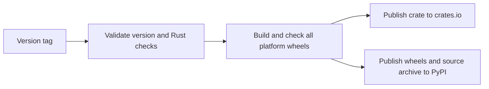

# Publishing

Brachio uses one version for crates.io and PyPI. `Cargo.toml` is the version source. Maturin reads this version and packages the Rust executable with `bindings = "bin"`. There is no Python CLI implementation or Python library API.

## Local verification

Install Rust stable, Cargo, uv, and Python 3.12. Run from the repository root:

```sh
cargo fmt --all -- --check
cargo clippy --locked --all-targets -- -D warnings
cargo test --locked --all-targets
cargo build --locked --release
cargo publish --locked --dry-run
uv lock --check
uv build
uvx --isolated --no-index --find-links dist brachio --version
uvx --isolated --no-index --find-links dist brachio --help
```

Use `--allow-dirty` with the Cargo dry run only to check uncommitted local changes. Do not use it for an upload. A dry run does not upload the crate or verify registry credentials.

`uv build` builds a source archive and then builds a wheel from that archive. Wheel installs do not need Rust. Source installs need Rust and Cargo. Python package metadata requires Python 3.10 or newer.

The Checks workflow runs Rust tests and source-to-wheel builds on Linux and macOS. Installed wheel version and help checks do not start the TUI or call Rex.

## Registry setup

A repository maintainer must complete these steps before the first automated release:

1. Confirm ownership and availability of `brachio` on crates.io and PyPI. Check similar names before publication.
2. Create GitHub environments named `crates-io` and `pypi`.
   - Restrict deployments to release tags that start with `v`.
   - Add required reviewers if each registry upload needs approval.
3. Configure [crates.io Trusted Publishing](https://crates.io/docs/trusted-publishing) for `brachio`.
   - The crate must already exist. Its first publication requires a separate, authorized API-token upload by a crate owner. Do not store this token as a GitHub Actions secret.
   - In the crate's Settings → Trusted Publishing, add GitHub repository owner `narumiruna`, repository `brachio`, workflow filename `publish.yml`, and environment `crates-io`.
   - After the initial publication, prepare a new, unused version for the tag-triggered workflow. Do not use the initial published version as the next automated release.
4. Store a PyPI API token as the `PYPI_TOKEN` secret in the `pypi` environment.
   - Before the PyPI project exists, the first upload needs an account-scoped token.
   - After the first upload, replace it with a token scoped to `brachio`.

The crates.io job uses `rust-lang/crates-io-auth-action` to exchange GitHub OIDC identity for a short-lived token. It passes the action's output to Cargo through `CARGO_REGISTRY_TOKEN`; no persistent crates.io secret is required. The action revokes the token when the job ends. Only this job has `id-token: write` permission.

PyPI uses the `PYPI_TOKEN` secret, not Trusted Publishing. Other jobs have only `contents: read` GitHub permission. Do not put token values in source files, issues, or chat.

## Automated publication

The `.github/workflows/publish.yml` workflow starts when a `v*.*.*` tag is pushed. Manual dispatch also requires a version tag; dispatch from a branch fails validation without an upload.



The release tag must be exactly `v<version>`, where `<version>` is a stable `MAJOR.MINOR.PATCH` version in `Cargo.toml`. The local package version in `Cargo.lock` must match. Prerelease tags are not supported.

The workflow first runs the Rust checks and a crate publication dry run. It then builds and installs each native wheel:

| Platform | Architecture | Runner |
| --- | --- | --- |
| Linux, glibc 2.28 or newer | x86_64 | `ubuntu-latest` |
| Linux, glibc 2.28 or newer | aarch64 | `ubuntu-24.04-arm` |
| macOS | x86_64 | `macos-15-intel` |
| macOS | aarch64 | `macos-14` |

The Linux x86_64 job also builds the source archive. Windows and Alpine/musl wheels are not included. Each installed wheel must report the validated version and accept `--help`. Both upload jobs wait until validation and every wheel build pass. Registry uploads then run independently.

To prepare an authorized release:

1. Update `package.version` in `Cargo.toml`.
2. Run `cargo update --workspace` to update the local package version in `Cargo.lock`, then run `uv lock` to refresh Python dependency metadata. The dynamic root version need not appear in `uv.lock`. Inspect the diff for unrelated changes.
3. Run the local verification commands and commit the intended files.
4. Review the Linux and macOS Checks jobs and the [Rex compatibility limits](rex-compatibility.md#external-handoff).
5. Create and push the matching tag only after release authorization. For version 0.1.0:

   ```sh
   git tag v0.1.0
   git push origin v0.1.0
   ```

A normal branch push or pull request does not publish. Do not move a tag after either registry has received its version.

## Partial failures and recovery

The two registry uploads are not a transaction. One can succeed while the other fails.

Use GitHub Actions **Re-run failed jobs** for the same tagged run. This retains successful build artifacts and does not repeat a successful registry job. A manual dispatch on the same tag runs the whole workflow again and can fail if the crate version is already published.

The PyPI upload uses `uv publish --check-url https://pypi.org/simple/`. Matching uploaded files are skipped; files with different contents are rejected. If a rebuilt wheel conflicts, inspect the original artifacts instead of replacing published files.

Crates.io does not permit a second upload of an existing version. If Cargo reports a failure after a possible upload, inspect the registry before retrying. Do not assume that an error means no write occurred.

Before publication, revert the packaging or workflow change to disable it. After publication, fix a faulty release with a new version. Registry yanks are separate maintainer actions and do not remove installed copies.

## Verification handoff

Local verification can establish host-platform Rust behavior, source archive completeness, and installed wheel behavior. It does not verify registry name ownership, the initial crate upload, Trusted Publishing configuration, PyPI tokens, environment approval rules, real uploads, or wheel behavior on other platforms.

The maintainer must verify all four native wheel jobs and both registry uploads during an authorized release. Retain the native Rex UI checks in the compatibility guide; successful packaging does not establish end-to-end Rex support.
