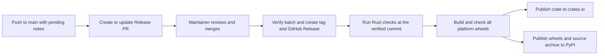

# Publishing

Brachio uses one version for crates.io and PyPI. `Cargo.toml` is the version source. Maturin reads this version and packages the Rust executable with `bindings = "bin"`. There is no Python CLI implementation or Python library API.

## Change notes

[changenote](https://github.com/narumiruna/changenote) manages pending notes, versions, changelogs, and local annotated tags. It does not publish registry artifacts.

Run the same pinned version used by the PR workflow with uv and Python 3.12 or newer:

```sh
uvx changenote==0.9.2 status
```

No separate tool installation is required. Compatible wheels do not need Rust or Cargo. Use `uvx changenote==0.9.2` in place of `changenote` in the commands below.

Run commands from the repository root. `.changenote/config.json` defines one package, `brachio`, with `Cargo.toml` as its primary version file and `v` as its tag prefix. Do not add the dynamic Python version as an additional version output.

Add or update a note for features, fixes, breaking changes, and installation or other user-facing changes that need a release:

```sh
changenote add fix-navigation --package brachio --bump patch --message "Fix navigation to the selected agent."
changenote status
```

Use `minor` for compatible features, `patch` for compatible fixes, and `major` for breaking changes. Include migration steps for breaking changes. Changenote applies stable SemVer rules even before 1.0.0. Update an existing note for the same change instead of adding a duplicate.

Documentation-only changes, test-only changes, internal refactors, and release-tooling setup need no note unless they affect users or release artifacts. State the reason in the completion report or PR description. Do not create empty notes or invent a bump. Invalid pending notes must be fixed, not deleted or hidden by an exemption.

### PR checks

The `notes` job in the Release workflow runs only on pull requests, with read-only permissions and no release credentials. It uses `uvx` to run a pinned CLI version from PyPI, not contributor code. Pending releases and PR check results are printed as JSON in the job logs. Keep the CLI and schema pins compatible when upgrading.

Manual Release runs skip PR note comparison because `github.base_ref` is unavailable outside PR events. They run the selected release operation instead.

The configured check paths are `src/**`, `Cargo.toml`, `Cargo.lock`, `pyproject.toml`, `uv.lock`, and `.github/workflows/release.yml`. Changes to these paths normally require a new or updated changenote entry for `brachio`, subject to the automatic rules below. Review release effects outside these paths manually. An unchanged old note does not satisfy a PR check.

For a clean, committed local comparison:

```sh
changenote check --since origin/main --coverage package
```

Fetch the base ref before checking if it is unavailable. The configured default base is `origin/main`; CI uses the actual PR base branch. Uncommitted changes are not checked.

The script automatically selects the missing-entry policy from the committed changes since the merge base:

- Changes only under `docs/`, `tests/`, or `.github/`, plus `.changenote/*.md`, `.changenote/config.json`, `README.md`, and `AGENTS.md`, automatically waive the missing-entry requirement.
- A managed Release PR needs no new entry when all these conditions hold:
  - Its head and base repositories match the current repository, and its base branch matches the comparison branch.
  - Its head branch is `narumi/chore/changenote-release-<base>`, and its body starts with `<!-- changenote-release-pr -->`.
  - It changes a regular `.changenote/releases.json` file and changes only that file, `.changenote/*.md`, `Cargo.toml`, `Cargo.lock`, or `CHANGELOG.md`.
- All other changes use normal package coverage, including source files, manifests, mixed changes, and unknown paths.

The script supplies `--skip-release --reason` automatically for the first two cases. It does not use PR labels or commit messages. Renames include both old and new paths. Configuration, versions, and pending entries are still validated; the release Action remains responsible for batch and generated-tree validation before publication.

## Local verification

Install Bash, Git, jq, Rust stable, Cargo, uv, and Python 3.12. Run from the repository root:

```sh
bash -n .github/scripts/check-pr-notes.sh
uv run --no-project --with pyyaml==6.0.3 python -m unittest discover -s tests/workflows -v
cargo fmt --all -- --check
cargo clippy --locked --all-targets -- -D warnings
cargo test --locked --all-targets
cargo build --locked --release
cargo publish --locked --dry-run
uv lock --check
uv build
uvx --isolated --no-index --find-links dist brachio --version
uvx --isolated --no-index --find-links dist brachio --help
```

Use `--allow-dirty` with the Cargo dry run only to check uncommitted local changes. Do not use it for an upload. A dry run does not upload the crate or verify registry credentials.

`uv build` builds a source archive and then builds a wheel from that archive. Wheel installs do not need Rust. Source installs need Rust and Cargo. Python package metadata requires Python 3.10 or newer.

The Checks workflow runs release-workflow regression tests, plus Rust tests and source-to-wheel builds on Linux and macOS. Installed wheel version and help checks do not start the TUI or call Rex.

## Release automation setup

The `.github/workflows/release.yml` workflow contains PR note checks, Release PR management, GitHub publication, validation, wheel builds, and registry uploads. It replaces the separate Changenotes and Publish workflows.

The PR note check uses `.github/scripts/check-pr-notes.sh` to inspect the merge-base diff and, for managed releases, the GitHub PR event. The token guard stays inline because it runs before checkout. The installed-wheel check stays inline because a retried release can use an older commit without the script. Simple build and publish commands also stay inline.

The release job uses the pinned `narumiruna/changenote/release` Action. The Action builds and caches a compatible CLI from its own source, not from Brachio. It prepares the Cargo cache before offline version updates. The PR notes job still runs its CLI through `uvx`.

A repository maintainer must add an Actions secret named `PAT_TOKEN` before enabling Release runs:

1. Use a fine-grained personal access token with access to this repository and `Contents: read and write` and `Pull requests: read and write` permissions.
   - Also grant `Workflows: read and write` so the managed release branch can include workflow changes from `main`.
   - A classic token instead needs `repo` and `workflow` scopes.
2. The token owner must be permitted to push the managed release branch, create PRs, and create version tags and GitHub Releases. Repository rules still apply.
3. Keep the token value in the Actions secret. Do not put it in files, issues, logs, or chat. Renew it before expiration.

The release job fails before checkout if `PAT_TOKEN` is absent. It does not fall back to `GITHUB_TOKEN`. Checkout has read-only permissions and does not retain credentials; only the release job receives the PAT for its Git pushes and API writes.

PAT-created PRs trigger Checks and the read-only notes job in Release. PR events cannot run the release job or registry uploads. The default `GITHUB_TOKEN` does not trigger checks on its own PR events. The repository setting that permits GitHub Actions to create PRs does not replace the PAT or its permissions.

Registry jobs depend on the release job in the same run. The workflow does not listen for tag pushes, so a PAT-created tag cannot start a duplicate publication run.

Reserve `narumi/chore/changenote-release-main` for the Action. It creates or updates one Release PR from pending notes and never merges it. Before merging that PR:

1. Review the version, consumed notes, changelog, and lockfile changes. Do not edit the generated release tree by hand.
2. Confirm that the script recognizes the managed Release PR automatically and that only generated outputs and consumed entries changed.
3. Wait for the PR checks and complete the registry setup below. Merging the Release PR starts GitHub publication, release validation, wheel builds, and registry uploads in the same run.

## Registry setup

A repository maintainer must complete these steps before merging the first Release PR:

1. Confirm ownership and availability of `brachio` on crates.io and PyPI. Check similar names before publication.
2. Create GitHub environments named `crates-io` and `pypi`.
   - Restrict deployments to the `main` branch. Registry jobs now run in Release on `main`, not in a tag-triggered workflow.
   - Add required reviewers if each registry upload needs approval.
3. Configure [crates.io Trusted Publishing](https://crates.io/docs/trusted-publishing) for `brachio`.
   - The crate must already exist. Its first publication requires a separate, authorized API-token upload by a crate owner. Do not store this token as a GitHub Actions secret.
   - In the crate's Settings → Trusted Publishing, add GitHub repository owner `narumiruna`, repository `brachio`, workflow filename `release.yml`, and environment `crates-io`.
   - Update an existing publisher that still names `publish.yml` before using the merged workflow.
   - After the initial publication, prepare a new, unused version for Release. Do not use the initial published version as the next automated release.
4. Store a PyPI API token as the `PYPI_TOKEN` secret in the `pypi` environment.
   - Before the PyPI project exists, the first upload needs an account-scoped token.
   - After the first upload, replace it with a token scoped to `brachio`.

The crates.io job uses `rust-lang/crates-io-auth-action` to exchange GitHub OIDC identity for a short-lived token. It passes the action's output to Cargo through `CARGO_REGISTRY_TOKEN`; no persistent crates.io secret is required. The action revokes the token when the job ends. Only this job has `id-token: write` permission.

PyPI uses the `PYPI_TOKEN` secret, not Trusted Publishing. Other jobs have only `contents: read` GitHub permission. Do not put token values in source files, issues, or chat.

## Automated publication

### Release PRs and GitHub publication

On pushes to `main`, the release job uses operation `auto`. It manages the Release PR and publishes the latest incomplete validated release batch. After a generated Release PR is merged, the Action verifies its saved batch and generated tree, creates the annotated version tag, and creates the GitHub Release. It passes the verified release commit and metadata to the validation and registry jobs.

The Action can complete an older incomplete batch on a later `main` push; it does not require a new batch in that push. Do not merge another Release PR until the current batch and registry uploads are complete. Runs on the same ref are serialized. PR refs have separate concurrency groups and cannot replace a pending `main` release. A later push does not cancel an active run.

Run Release manually only on `main`:

1. `manage-pr` is the default. It creates or updates the Release PR without publishing.
2. `retry-publication` retries the latest validated batch, including registry validation, builds, and uploads even when its GitHub tag and Release already exist. It does not merge a PR. For partial registry failures, prefer **Re-run failed jobs** as described below.

### Registry publication

Validation starts only after a successful release job returns a nonempty verified release commit. PR events, manual `manage-pr` operations, and pushes without an incomplete batch do not run registry jobs. A failed release job also prevents registry uploads.

Changenote owns release metadata validation. Rust checks, wheel builds, and Cargo publication use its verified commit. Wheel version checks use the version from the Action's `releases` output. The workflow does not repeat metadata validation or use the triggering branch name as a version tag.



The release tag must be exactly `v<version>`, where `<version>` is a stable `MAJOR.MINOR.PATCH` version in `Cargo.toml`. The local package version in `Cargo.lock` must match. Prerelease tags are not supported.

The workflow first runs the Rust checks and a crate publication dry run. It then builds and installs each native wheel:

| Platform | Architecture | Runner |
| --- | --- | --- |
| Linux, glibc 2.28 or newer | x86_64 | `ubuntu-latest` |
| Linux, glibc 2.28 or newer | aarch64 | `ubuntu-24.04-arm` |
| macOS | x86_64 | `macos-15-intel` |
| macOS | aarch64 | `macos-15` |

The Linux x86_64 job also builds the source archive. Windows and Alpine/musl wheels are not included. Each installed wheel must report the validated version and accept `--help`. Both upload jobs wait until validation and every wheel build pass. Registry uploads then run independently.

Adding notes does not merge or publish a release. Once automation is enabled, a maintainer merges the generated Release PR to start its release. Separate manual versioning, local tag creation, tag pushes, GitHub Releases, and registry uploads still require explicit authorization.

### Manual release preparation

Use this procedure only when preparing a release outside the automatic Release PR workflow. Disable Release during manual preparation to prevent automatic publication of the batch. Do not run it against an Action-managed release branch.

To prepare an authorized version change:

1. Start from a clean checkout with committed notes. Run `changenote status` and review the package, bump, summaries, and target version.
2. Populate the package caches with `cargo fetch --locked` and `uv build` before versioning. Changenote refreshes the existing `Cargo.lock` with `cargo update --workspace --offline`.
3. Run `changenote version` only with explicit versioning authorization. It updates `Cargo.toml` and `Cargo.lock`, writes `CHANGELOG.md` and `.changenote/releases.json`, and removes consumed notes. Do not edit the generated release tree by hand.
4. Run `uv lock --offline` separately to refresh Python dependency metadata. The dynamic Python version is not a configured changenote output and need not appear in `uv.lock`. Inspect the diff for unrelated changes.
5. Run `changenote status` again and confirm that the consumed notes are no longer pending. Run the local verification commands and review the Linux and macOS Checks jobs and the [Rex compatibility limits](rex-compatibility.md#external-handoff).
6. Commit only the intended release files, including entry deletions, the saved batch, changelog, manifests, and changed lockfiles. PRs outside the managed Release PR rules use normal package coverage.

After the release commit is merged and the checkout is clean, create local tags only with separate tag authorization:

```sh
changenote tag
```

This uses the saved release batch to create an annotated `v<version>` tag. Push only the intended tag after separate publication authorization. For version 0.1.0:

```sh
git push origin refs/tags/v0.1.0
```

Feature-branch pushes and ordinary PRs do not publish. Tag pushes alone do not start registry uploads. After manual preparation, re-enable Release only with publication authorization and use `retry-publication` on `main` to publish the latest validated batch. Do not move a tag after either registry has received its version.

## Partial failures and recovery

The two registry uploads are not a transaction. One can succeed while the other fails.

For a failed job, use GitHub Actions **Re-run failed jobs** on the same Release run. This retains successful release-job outputs and wheel artifacts and does not repeat a successful registry job.

For an explicit retry of the latest batch, run Release on `main` with `operation=retry-publication`. Existing tags and release text are not replaced. Registry validation, builds, and uploads run again even when GitHub publication has no remaining work. This whole-batch retry can fail if the crate version is already published; prefer the original run's failed-job retry after a partial registry failure.

The PyPI upload uses `uv publish --check-url https://pypi.org/simple/`. Matching uploaded files are skipped; files with different contents are rejected. If a rebuilt wheel conflicts, inspect the original artifacts instead of replacing published files.

Crates.io does not permit a second upload of an existing version. If Cargo reports a failure after a possible upload, inspect the registry before retrying. Do not assume that an error means no write occurred.

If local versioning fails, stop and inspect Git state. Changenote attempts to restore its known release files, but recovery is not atomic. Do not discard unrelated changes or retry without checking the result.

Disable Release to stop automatic PR updates, GitHub publication, and registry uploads. Disabling a workflow does not cancel a run already in progress. After publication, fix a faulty release with a new version. Registry yanks are separate maintainer actions and do not remove installed copies.

## Verification handoff

A maintainer must configure `PAT_TOKEN` and review required branch checks for the `notes` job in Release. Update the crates.io Trusted Publisher workflow filename to `release.yml` and allow `main` in both registry environments before merging a Release PR.

Verify that a PAT-created Release PR starts Checks and only the notes job in Release. During an authorized release, verify that validation and uploads follow the verified release commit within the same run, with no second tag-triggered run. Local tests do not establish token permissions, branch rules, deployment approvals, hosted Action behavior, or event delivery.

Supply the PAT and registry prerequisites before using automation. Implementation and local verification do not authorize a Release dispatch or a publication.

Local verification can establish host-platform Rust behavior, source archive completeness, and installed wheel behavior. It does not verify registry name ownership, the initial crate upload, Trusted Publishing configuration, PyPI tokens, environment approval rules, real uploads, or wheel behavior on other platforms.

The maintainer must verify all four native wheel jobs and both registry uploads during an authorized release. Retain the native Rex UI checks in the compatibility guide; successful packaging does not establish end-to-end Rex support.
